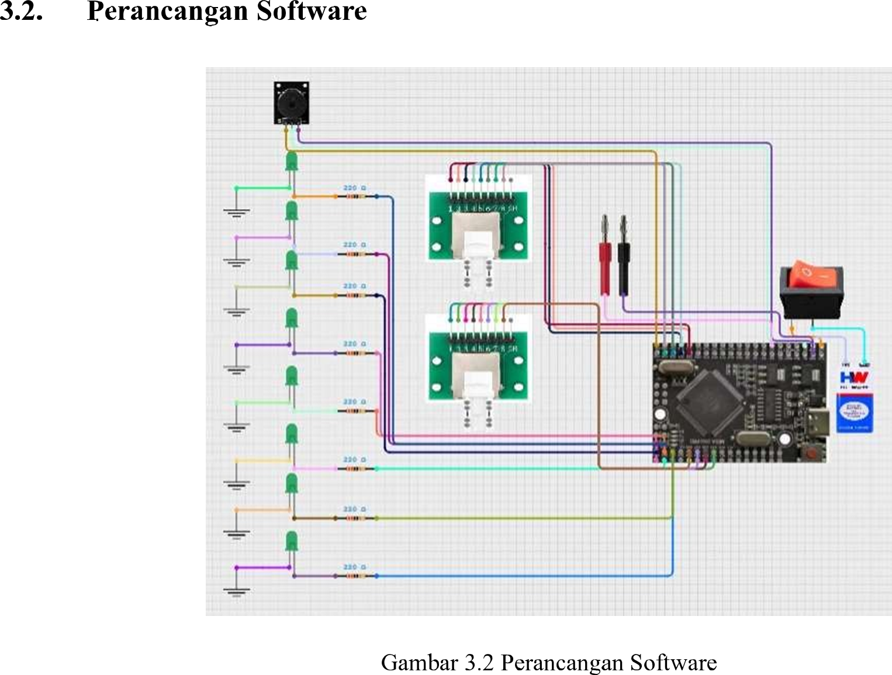
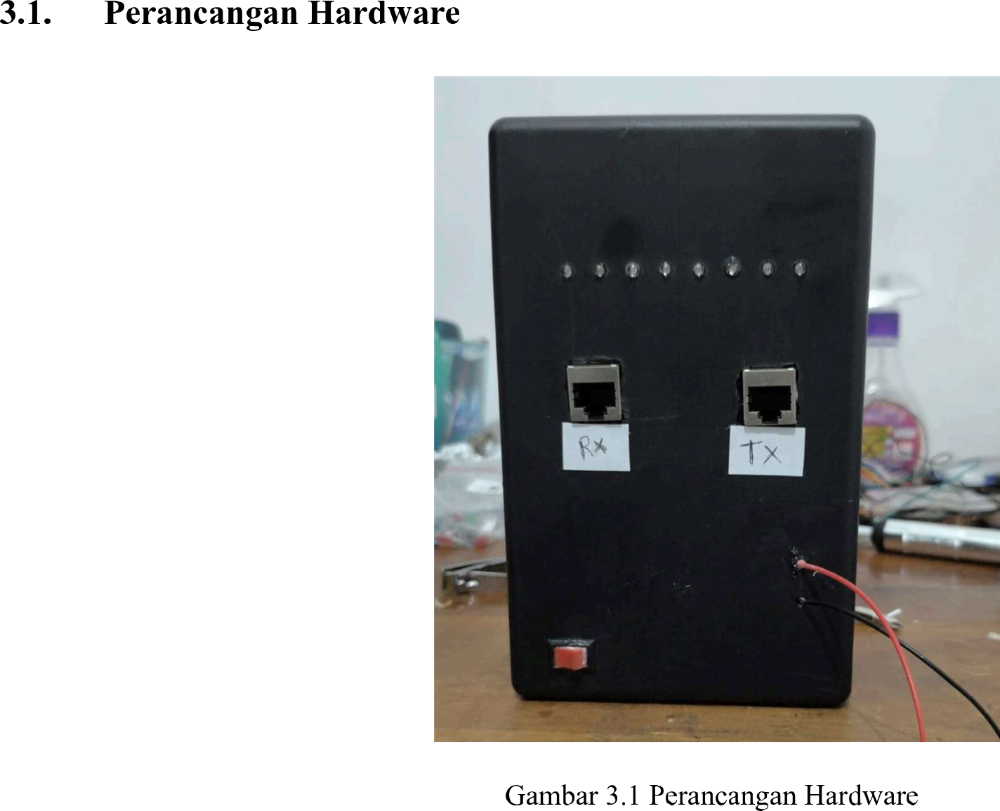

# Prototipe Alat Penguji Kabel Jaringan RJ-45 dan Komunikasi Serial RS-232 Berbasis Arduino Mega
*(Proyek Praktikum Komunikasi Data - Politeknik Elektronika Negeri Surabaya)*

## 📝 Deskripsi Proyek
Proyek ini merealisasikan sebuah prototipe alat portabel terintegrasi untuk menguji konektivitas kabel jaringan RJ-45 (mendeteksi hubungan pin, jalur putus, atau salah pasang) serta memverifikasi fungsi komunikasi serial RS-232 (arah TX/RX) secara otomatis berbasis mikrokontroler Arduino Mega 2560.

## 👷 Kontribusi Spesifik Saya (My Role)
Proyek ini merupakan proyek kolaboratif berskala kelas. Pengerjaannya dibagi berdasarkan spesialisasi, di mana kontribusi spesifik saya berfokus pada fase **Hardware Assembly & Physical Integration**:
- **Perakitan Jalur Fisik:** Membantu menata letak konektor fisik RJ-45 (sisi TX & RX) serta port komunikasi serial DB9 di atas papan PCB Bolong double layer.
- **Teknik Penyolderan:** Melakukan penyolderan komponen pasif, LED indikator (Pin 1 hingga Pin 8), dan buzzer menggunakan timah secara kuat untuk memastikan kontinuitas sinyal listrik stabil dan menghindari hubung singkat.
- **Troubleshooting Fisik:** Membantu tim melakukan pengecekan kontinuitas fisik awal sebelum komponen mikrokontroler diintegrasikan dengan kode program.

## 📐 Perancangan Sistem & Komponen
Berdasarkan dokumen perancangan sistem praktikum, alat ini dibangun menggunakan:
- **Alat & Bahan:** Solder, timah, kabel jumper, PCB header, PCB bolong double layer, buzzer, LED indikator, dan Arduino Mega.
- **Skema Rangkaian:** Jalur pengabelan (*wiring*) dipetakan dari pin digital Arduino Mega menuju konektor uji fisik.

### 📷 Dokumentasi Rangkaian & Fisik Alat
*(Pastikan Anda sudah mengunggah file gambar skema dan foto alat ke repositori GitHub Anda)*
- **Skema Rangkaian (Wiring):**  
  
- **Implementasi Perangkat Keras Fisik:**  
  

## 📊 Hasil Pengujian Laboratorium (Data Valid Laporan)
- **Pengujian Kabel LAN (Straight):** Sukses memvalidasi bahwa seluruh Pin 1 hingga Pin 8 berstatus **Terhubung**. Interpretasi hasil menunjukkan pola seluruh LED menyala secara berurutan dan buzzer tidak berbunyi (Kabel BAIK).
- **Pengujian Kabel Serial RS-232:** Sukses memetakan hubungan pin fungsional secara silang (Pin 2 ke Pin 3, Pin 3 ke Pin 2, Pin 4 ke Pin 6, dst.) secara akurat sesuai standar komunikasi serial.
- **Sistem Indikator Fault:** Buzzer secara otomatis aktif berbunyi memberikan peringatan audio jika mendeteksi kondisi abnormal seperti kabel putus (*open circuit*) atau hubung singkat (*short circuit*).
